---

# Fundamentos teóricos de los componentes electrónicos

## Física, modelos y circuitos de aplicación

**Nivel universitario · Electrónica analógica y sistemas embebidos**

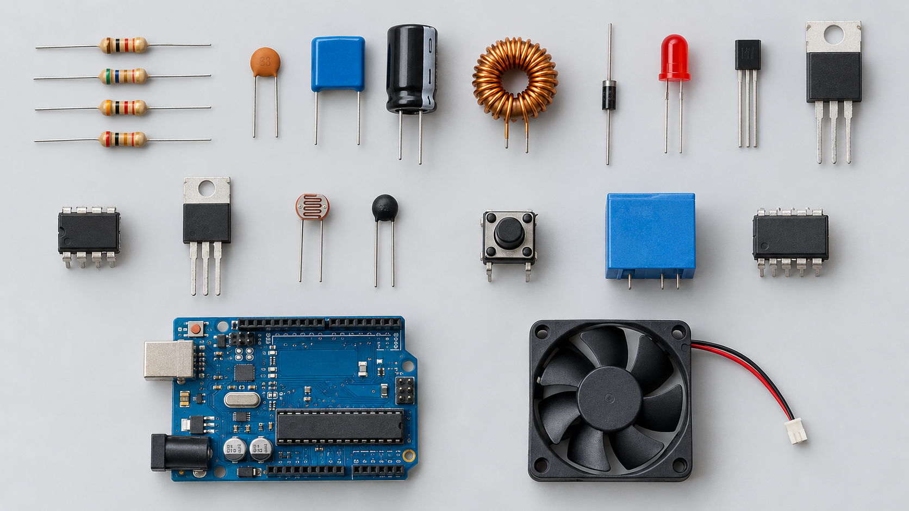

<!--
Notas del docente: La presentación usa fotografías e ilustraciones vectoriales locales; no depende de diagramas ASCII.
-->

---

## Objetivos de aprendizaje

- Relacionar física de semiconductores y modelos eléctricos.
- Analizar circuitos básicos con ecuaciones constitutivas.
- Interpretar símbolos, parámetros y límites de datasheets.
- Dimensionar componentes con márgenes eléctricos y térmicos.

<!--
Notas del docente: El foco es entender el dispositivo y también saber utilizarlo con seguridad.
-->

---

## Magnitudes y leyes fundamentales

- Tensión: diferencia de potencial, \(v\) (V).
- Corriente: \(i=dq/dt\) (A).
- Potencia: \(p=vi\) (W); energía: \(w=\int p(t)dt\).
- Kirchhoff: KCL en nodos y KVL en mallas.

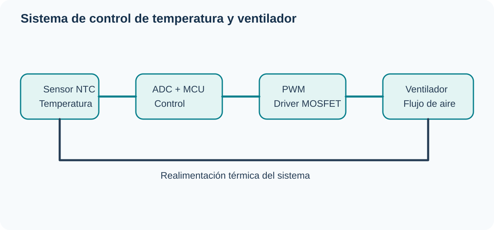

<!--
Notas del docente: La elección del modelo depende del rango de operación y del objetivo del análisis.
-->

---

## Resistor: modelo constitutivo

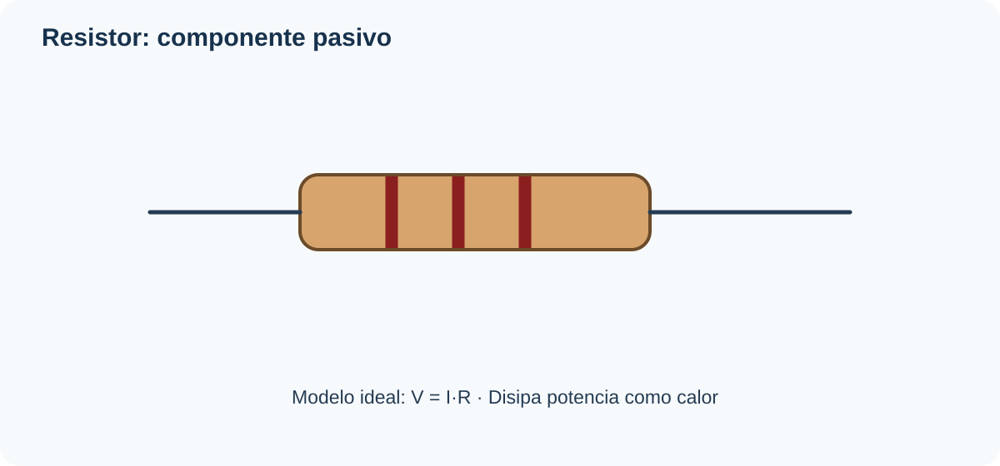

\[v=Ri,\qquad P=VI=I^2R=V^2/R\]

Parámetros reales: tolerancia, potencia nominal, coeficiente térmico, tensión máxima y ruido.

<!--
Notas del docente: El modelo óhmico es válido dentro del rango de operación especificado.
-->

---

## Aplicación: divisor de tensión

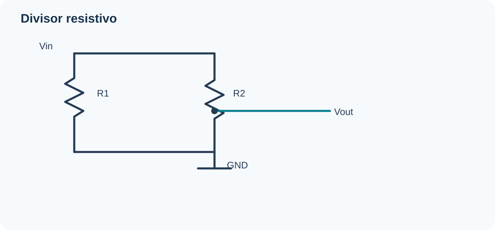

\[V_{out}=V_{in}\frac{R_2}{R_1+R_2}\]

La carga en paralelo con R₂ modifica la salida. No es un regulador de potencia.

<!--
Notas del docente: Ejemplo: 5 V, R1=R2=10 kΩ produce 2.5 V sin carga.
-->

---

## Capacitor: campo eléctrico

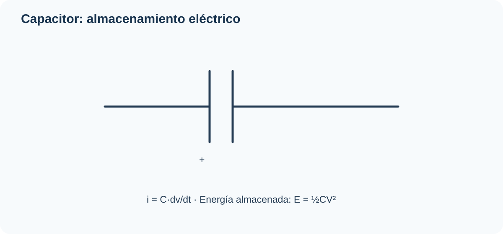

\[q=Cv,\quad i=C\frac{dv}{dt},\quad E=\frac12 CV^2\]

Parámetros: ESR, ESL, fuga, tolerancia y tensión máxima.

<!--
Notas del docente: Los capacitores polarizados requieren respetar la polaridad indicada por el fabricante.
-->

---

## Transitorio RC

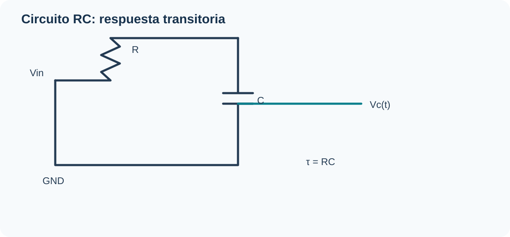

\[v_C(t)=V_S(1-e^{-t/RC}),\quad \tau=RC\]

A una constante de tiempo se alcanza aproximadamente 63.2 % del valor final; a 5τ, cerca de 99.3 %.

<!--
Notas del docente: RC aparece en temporización, desacoplo y filtrado.
-->

---

## Inductor: campo magnético

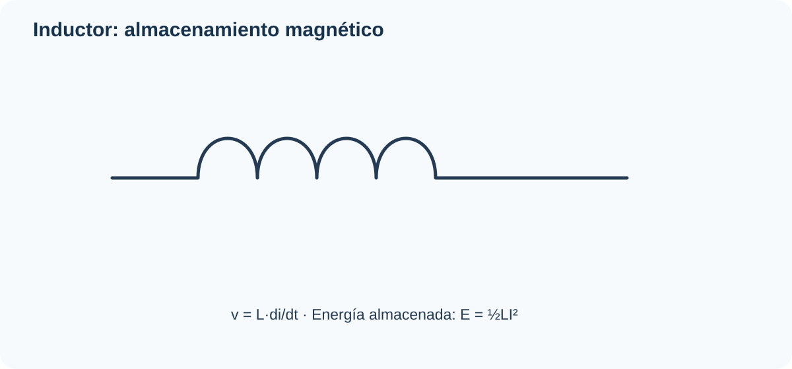

\[v=L\frac{di}{dt},\qquad E=\frac12 Li^2\]

Considerar resistencia de devanado, saturación, pérdidas y capacitancia parásita.

<!--
Notas del docente: Un inductor se opone a cambios de corriente; no bloquea la corriente en todas las condiciones.
-->

---

## Diodo PN y rectificación

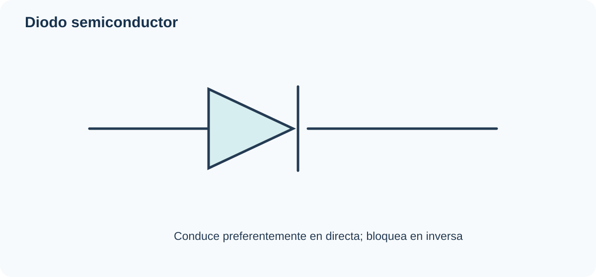

\[I_D=I_S(e^{V_D/(nV_T)}-1)\]

El valor de 0.7 V para silicio es una aproximación, no una constante universal.

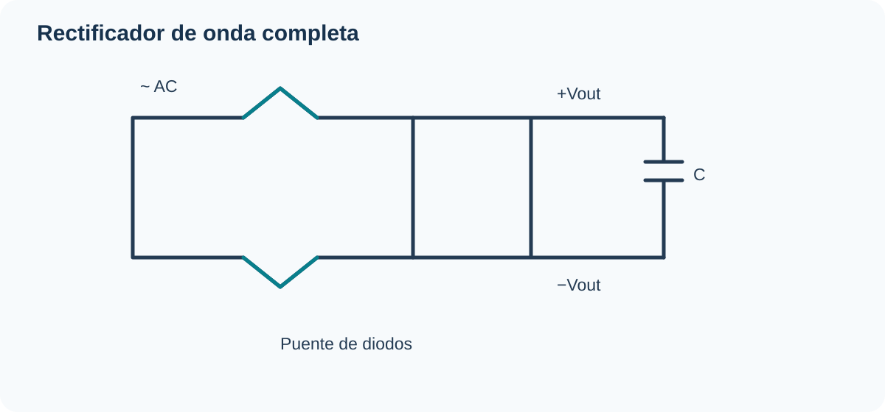

<!--
Notas del docente: Verificar corriente directa, tensión inversa, recuperación y disipación.
-->

---

## LED: emisión de luz

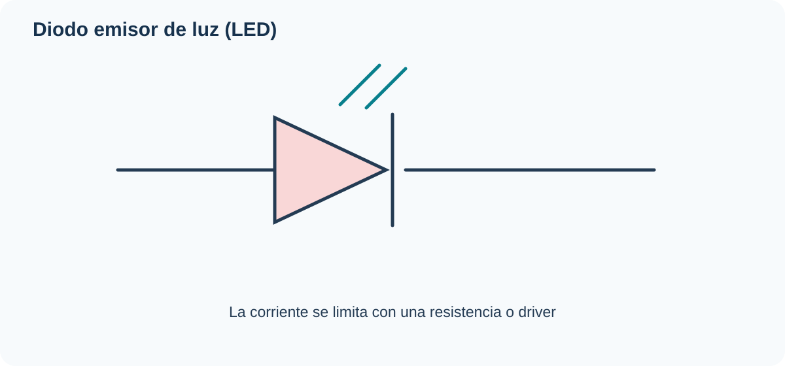

\[R=\frac{V_S-V_F}{I_F}\]

Ejemplo: 5 V, caída 2 V y 10 mA → 300 Ω; 330 Ω reduce la corriente.

<!--
Notas del docente: El LED es un dispositivo controlado en corriente; revisar corriente continua y potencia permitidas.
-->

---

## BJT: principio y regiones

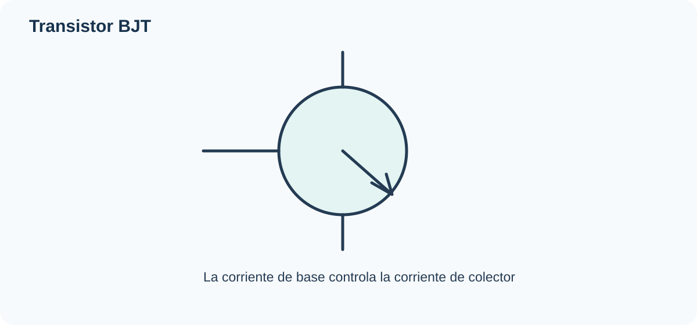

En región activa: \(I_C\approx\beta I_B\).

Regiones: corte, activa y saturación. β depende del dispositivo, corriente y temperatura.

<!--
Notas del docente: Para conmutación se diseña con saturación y ganancia forzada, no con el valor típico de β.
-->

---

## BJT como interruptor

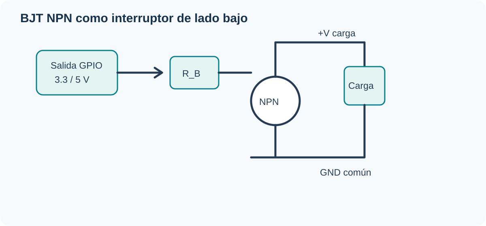

\[I_B\geq I_C/\beta_{forzada}\]

Verificar límite de GPIO, corriente de colector, VCE(sat) y disipación. Añadir protección si la carga es inductiva.

<!--
Notas del docente: El esquema de la diapositiva es un circuito vectorial ilustrativo; completar los valores según la carga real.
-->

---

## MOSFET: control por campo eléctrico

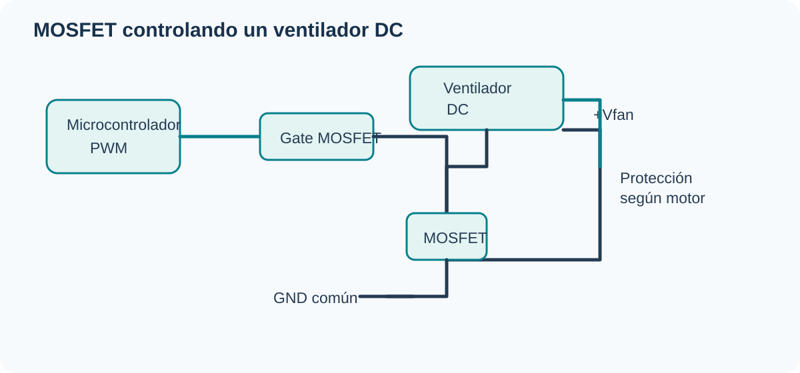

- Terminales: gate, drain y source.
- \(V_{GS(th)}\) no garantiza encendido completo.
- Seleccionar por \(R_{DS(on)}\) a la tensión de puerta real.
- Considerar carga de puerta, SOA y temperatura.

<!--
Notas del docente: El MOSFET reduce la pérdida de conducción si se selecciona y excita correctamente.
-->

---

## Op-amp: realimentación negativa

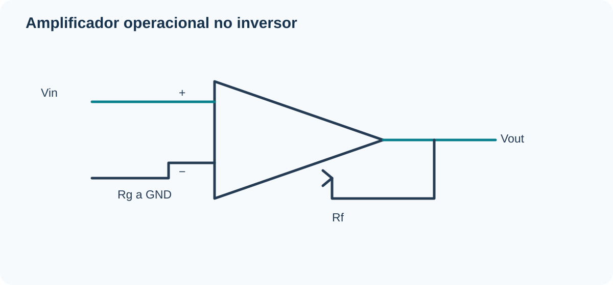

Inversor: \(A_v=-R_f/R_{in}\)

No inversor: \(A_v=1+R_f/R_g\)

Los dispositivos reales tienen offset, ruido, ancho de banda y límites de modo común.

<!--
Notas del docente: No asumir que la salida alcanza los rieles de alimentación: revisar el datasheet.
-->

---

## Sensores resistivos: NTC

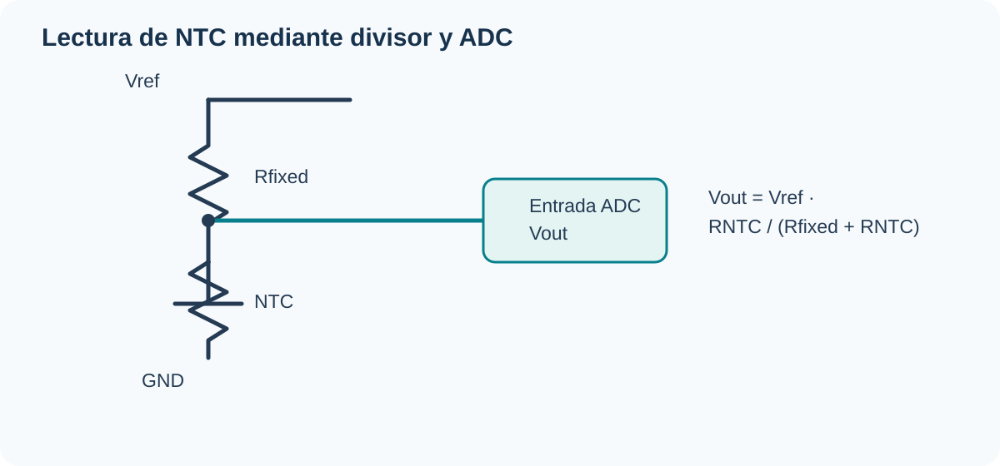

\[R(T)=R_0\exp[B(1/T-1/T_0)]\]

La temperatura está en kelvin. La precisión depende de tolerancias, autocalentamiento y curva de calibración.

<!--
Notas del docente: La resistencia fija debe elegirse según el intervalo de temperatura de interés.
-->

---

## Pulsador y pull-up

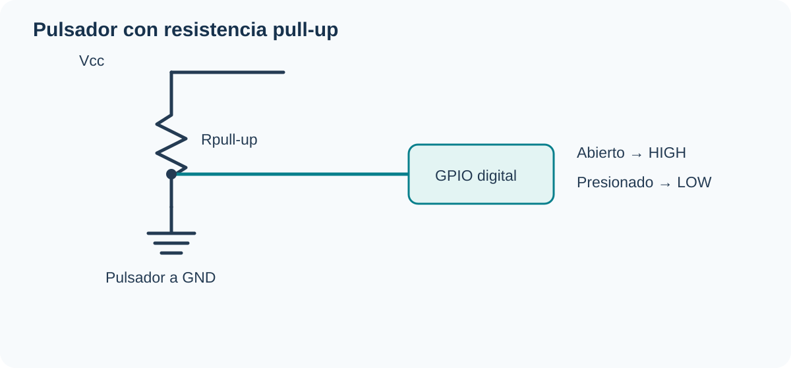

- Pull-up fija el nivel lógico cuando el contacto está abierto.
- El rebote mecánico puede generar varias transiciones.
- Debounce por hardware o software.
- Evitar entradas CMOS flotantes.

<!--
Notas del docente: El diagrama es una ilustración visual de la topología; verificar la configuración del GPIO.
-->

---

## Relés y cargas inductivas

- La bobina crea un campo magnético que mueve los contactos.
- La bobina necesita etapa de accionamiento.
- En bobina DC, usar diodo de rueda libre o protección apropiada.
- Verificar corriente de contacto, tensión, aislamiento y categoría de carga.

<!--
Notas del docente: La conmutación de red eléctrica requiere diseño y procedimientos de seguridad específicos.
-->

---

## Regulación de tensión

**Lineal:** sencillo y de bajo ruido; \(P\approx(V_{in}-V_{out})I_{out}\).

**Conmutado:** almacena y transfiere energía con interruptores, inductores y capacitores; suele ser más eficiente, pero puede generar EMI y rizado.

<!--
Notas del docente: Ejemplo: 12 V a 5 V y 0.5 A en regulador lineal implica unos 3.5 W de disipación.
-->

---

## Circuitos integrados y lógica digital

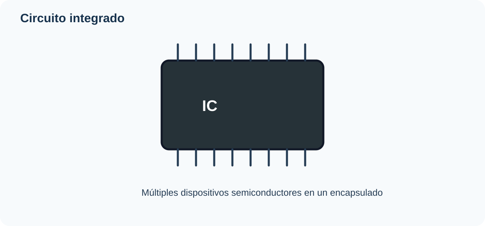

Verificar \(V_{IH}\), \(V_{IL}\), \(V_{OH}\), \(V_{OL}\), fan-out, corrientes y tolerancia a sobretensión.

Colocar desacoplo cerca de los pines de alimentación.

<!--
Notas del docente: La compatibilidad entre 3.3 V y 5 V no debe darse por sentada.
-->

---

## ADC y PWM

- ADC ideal de N bits: \(\Delta V\approx V_{ref}/2^N\).
- ADC de 10 bits y referencia 5 V: paso ≈4.88 mV.
- PWM modula ciclo de trabajo; en condiciones ideales, \(V_{medio}\approx D V_{in}\).
- PWM no equivale por sí mismo a un DAC verdadero.

<!--
Notas del docente: El filtro, la carga y la frecuencia de PWM determinan rizado y respuesta.
-->

---

## Sistema integrado: temperatura y ventilador

- NTC → divisor → ADC.
- Microcontrolador filtra y calcula la consigna.
- PWM → gate del MOSFET.
- Ventilador alimentado desde una fuente apropiada.
- Masa común, desacoplo y protección según el tipo de motor.

<!--
Notas del docente: Esta lámina sustituye el diagrama de texto por una ilustración de circuito vectorial.
-->

---

## Cómo leer un datasheet

1. Absolute maximum ratings: límites de supervivencia.
2. Recommended operating conditions: rango de operación.
3. Electrical characteristics: valores min/típ/max bajo condiciones especificadas.
4. Curvas vs. temperatura, corriente y frecuencia.
5. Encapsulado, pinout y parámetros térmicos.

<!--
Notas del docente: Los valores típicos no siempre están garantizados; diseñar para peor caso.
-->

---

## Errores de diseño frecuentes

| Componente | Qué revisar |
|---|---|
| Resistor | Potencia y tolerancia |
| Capacitor | Polaridad, ESR y tensión |
| Diodo | Tensión inversa y corriente |
| BJT | Saturación y corriente de base |
| MOSFET | RDS(on) al VGS real |
| Op-amp | Rango de entrada y salida |
| Sensor | Calibración y autocalentamiento |

<!--
Notas del docente: La validación debe incluir simulación, prototipo y medición.
-->

---

## Cierre y referencias

- Horowitz & Hill, *The Art of Electronics*.
- Sedra & Smith, *Microelectronic Circuits*.
- Boylestad & Nashelsky, *Electronic Devices and Circuit Theory*.
- [All About Circuits](https://www.allaboutcircuits.com/textbook/)
- [Texas Instruments](https://www.ti.com/) · [Analog Devices](https://www.analog.com/)

**Nota:** los diagramas son esquemas didácticos. Confirmar siempre conexiones y valores con la hoja de datos del componente concreto.

<!--
Notas del docente: Terminar conectando modelo físico, ecuación, circuito y validación experimental.
-->
