

  <h1>Protocolos de Hardware y Programación de Sensores</h1>
  
Sesión 3: Unidad 2 - Ecosistema de Arduino

Curso: Desarrollo de Hardware para Telesalud

  Mag. Ing. CIP Moises Stevend Meza Rodriguez

  Facultad de Ciencias e Ingeniería

---

---

## Introducción a Protocolos de Hardware

  <strong>¿Qué son los Protocolos Físicos?</strong>

* Establecen las normas de transporte para intercambiar datos de bioseñales de forma rápida y fidedigna entre sensores y el microcontrolador central.
* **Abstracción vs. Silicio:** Entornos como Arduino IDE ocultan la complejidad de los registros mediante su capa HAL, pero no alteran las limitaciones eléctricas ni físicas del hardware.

---

## Ecosistema de Comunicación

  <strong>Clasificación Principal</strong>

* **UART:** Transmisión asíncrona, bidireccional punto a punto.
* **I2C (TWI):** Protocolo síncrono para topologías multiesclavo compacto.
* **SPI:** Estándar síncrono dedicado a operaciones de muy alta velocidad.
* **CAN (TWAI):** Arquitectura automotriz inmune a ruidos extremos.

---

## Protocolo UART (Comunicación Asíncrona)

  <strong>Universal Asynchronous Receiver-Transmitter</strong>

* **Física:** Opera mediante 2 hilos (TX y RX) y 1 referencia obligatoria (GND).
* **Temporización:** Carece de línea de reloj compartida. Los dispositivos preacuerdan la velocidad o *Baud Rate* (ej. 115200 bps).
* **Aplicación:** GPS, Modems GPRS/LTE y enlaces Bluetooth BLE hacia los teléfonos del paciente.

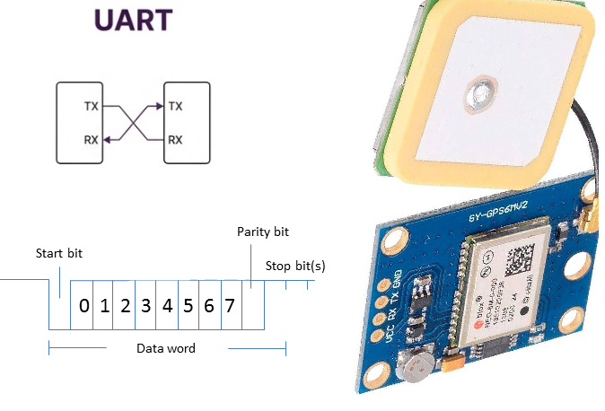

---

## Protocolo I2C (Inter-Integrated Circuit)

  <strong>Bus Síncrono de Drenador Abierto</strong>

* **Líneas físicas:** SDA (datos bidireccional) y SCL (pulso de reloj del maestro).
* **Restricción Eléctrica:** Se recomienda agregar externamente resistencias *Pull-up* (típicamente de 4.7 kΩ).
* **Aplicación:** Direccionamiento hexadecimal de mútiples sensores biomédicos acoplados en el mismo bus de 2 vías.

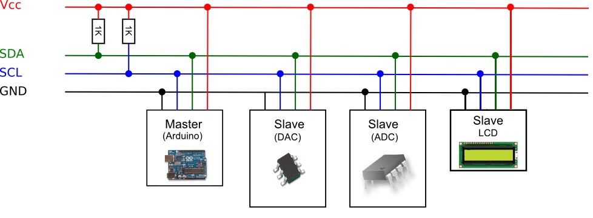

---

---

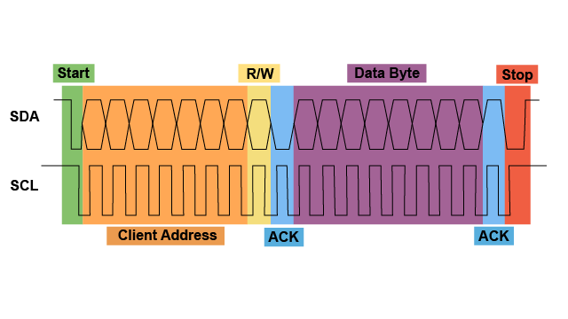

---

## Protocolo SPI (Serial Peripheral Interface)

  <strong>Bus Síncrono de Alta Velocidad</strong>

* **Full-Duplex:** Desplazamiento simultáneo (MOSI y MISO) impulsado por el reloj maestro (SCK) superando rangos de 10-50 MHz.
* **Selección de Esclavo:** Exige un hilo adicional discreto (CS/SS) por cada esclavo activo.
* **Aplicación:** Almacenamiento continuo (*datalogger*) en SD y gestión de pantallas gráficas (TFT) para monitores.

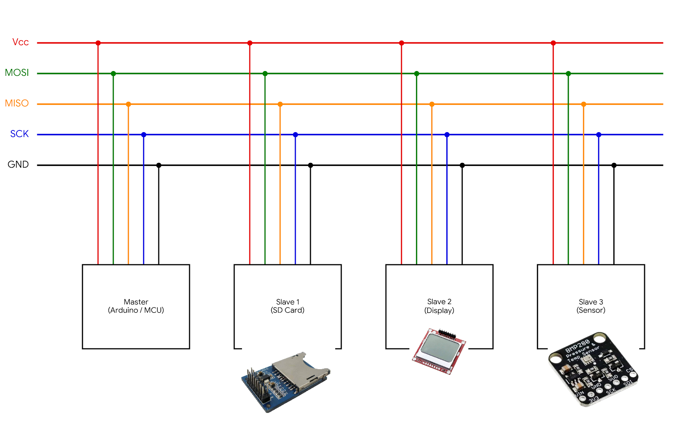

---

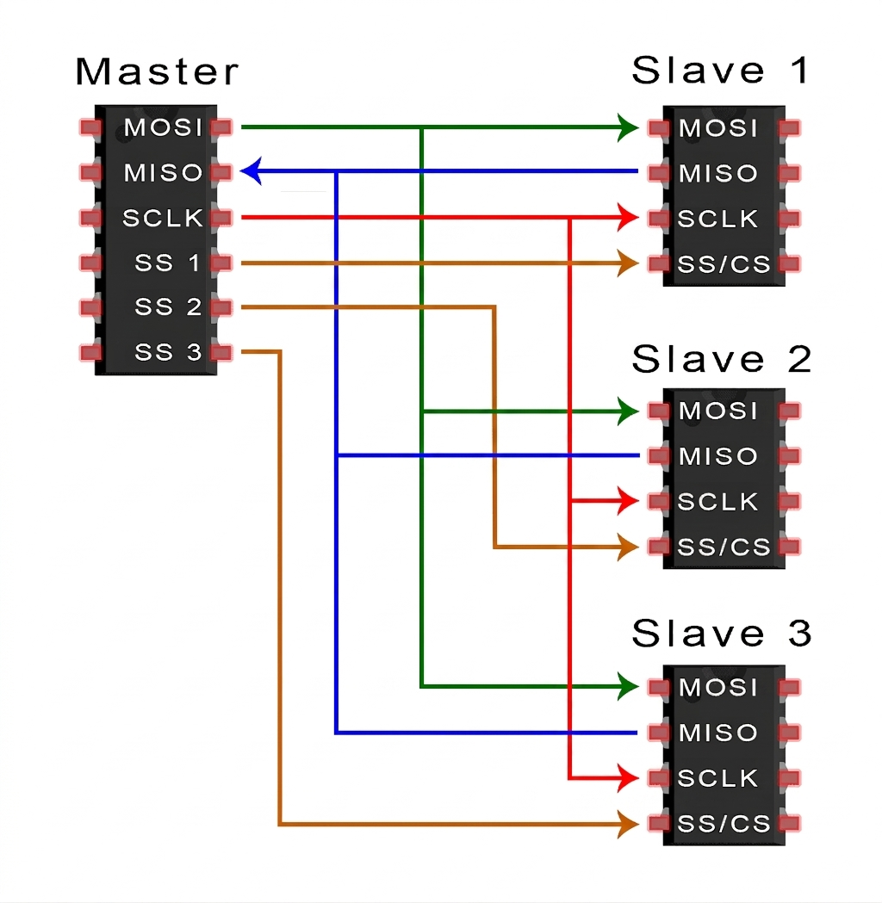

---

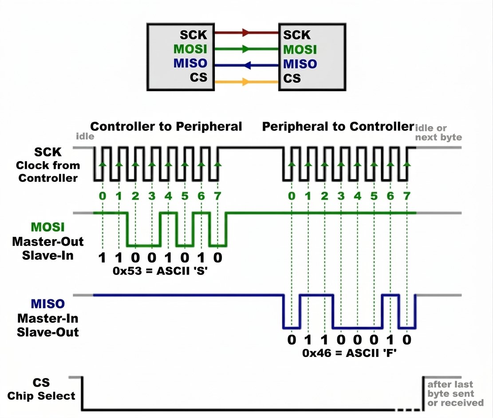

---

## Protocolo CAN Bus (TWAI)

  <strong>Comunicaciones Críticas Aisladas</strong>

* **Diferencial:** Protege las tramas de alta prioridad de la interferencia electromagnética severa.
* **Transceptor Externo:** El procesador maneja las capas digitales, pero es crítico incorporar un circuito integrado transceptor para acoplar la señal a las líneas CAN físicas.

---

## Adaptación Eléctrica (Level Shifting)

  <strong>Dominio 3.3V vs 5V</strong>

* **Riesgo:** Someter pines de placas avanzadas (3.3V) a señales directas de módulos antiguos (5V) destruye sus diodos de seguridad por sobretensión.
* **Translación I2C:** Exige chips bidireccionales basados en MOSFETs BSS138 por su característica de drenador abierto.
* **Translación SPI:** Demanda aceleradores activos de flanco o búferes rígidos debido a las velocidades extremas.

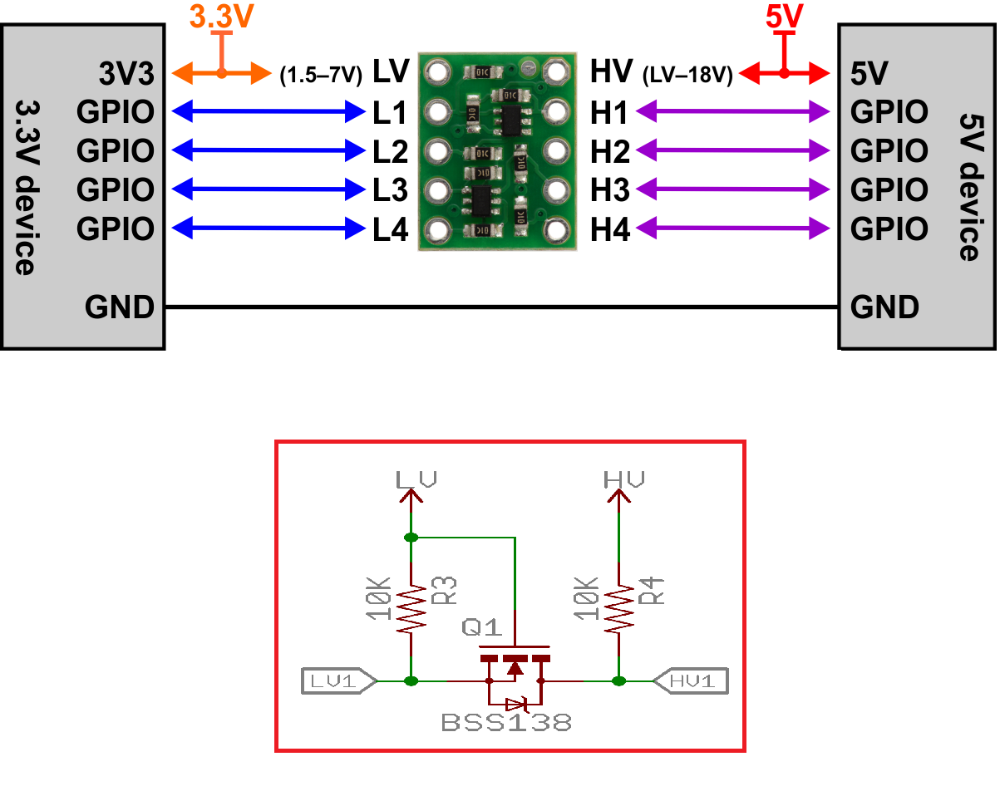

---

## Familia Clásica AVR (Arduino Uno)

  <strong>ATmega328P a 5V</strong>

* **Deficiencia UART:** Cuenta con 1 hardware UART. Acoplar un sensor asíncrono en los pines (0,1) choca con el tráfico USB de carga o depuración.
* **Bit-Banging:** Conlleva al uso oneroso de la biblioteca emuladora `SoftwareSerial`.
* **Hardware Estático:** Pines I2C (A4/A5) y SPI (11-13) no pueden redistribuirse.

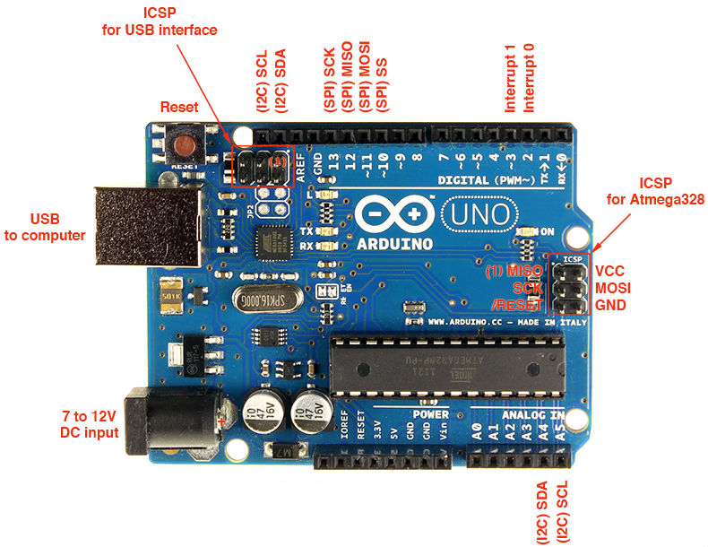

---

---

## Arduino Mega y Leonardo

  <strong>Expansión y Virtualización USB</strong>

* **ATmega2560:** Incluye 4 transceptores UART por hardware (`Serial1` a `Serial3`) idóneos para redes locales ricas en sensores.
* **ATmega32U4:** Integra el protocolo USB (CDC). Su clase base `Serial` es un puerto host virtualizado, desvinculando la actividad física en su UART secundario.
* **Advertencia Leonardo:** Sus líneas SPI físicas convergen exclusivamente sobre el cabezal ICSP central.

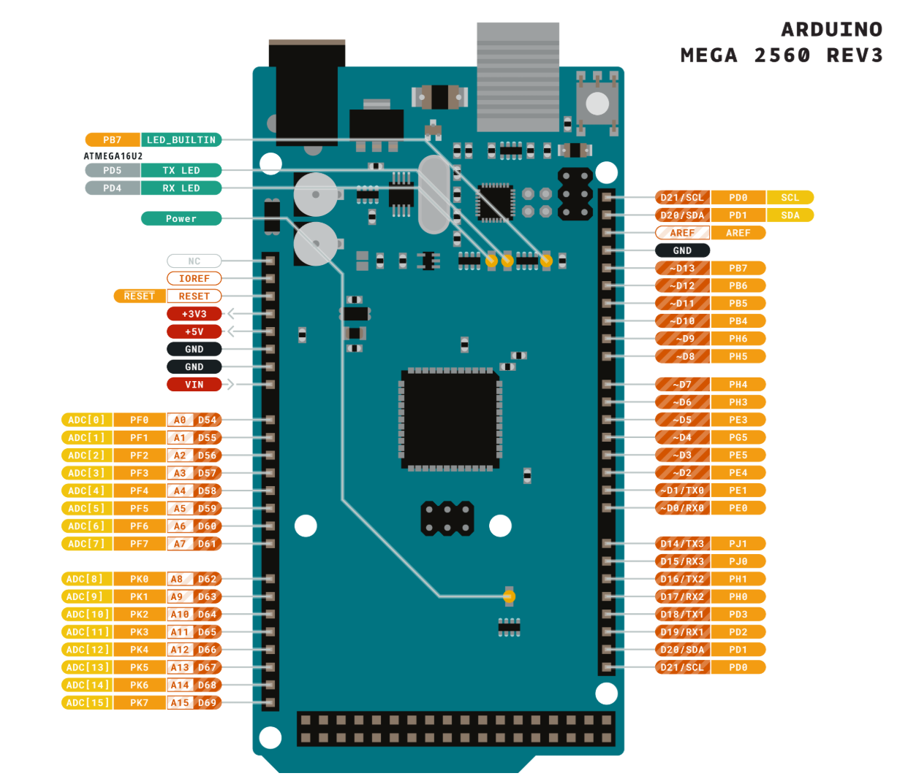

---

## Raspberry Pi Pico 2 (RP2350)

  <strong>Flexibilidad Mediante Máquinas de Estado</strong>

* **Matriz Inteligente:** Los controladores UART y SPI internos admiten enrutamiento físico guiado por la multiplexación de la placa.
* **Bloques PIO (I/O Programable):** Co-procesadores en miniatura con los que el Arduino Core (Philhower) emula controladores secundarios fluidos usando acceso a memoria (DMA) puro.

---

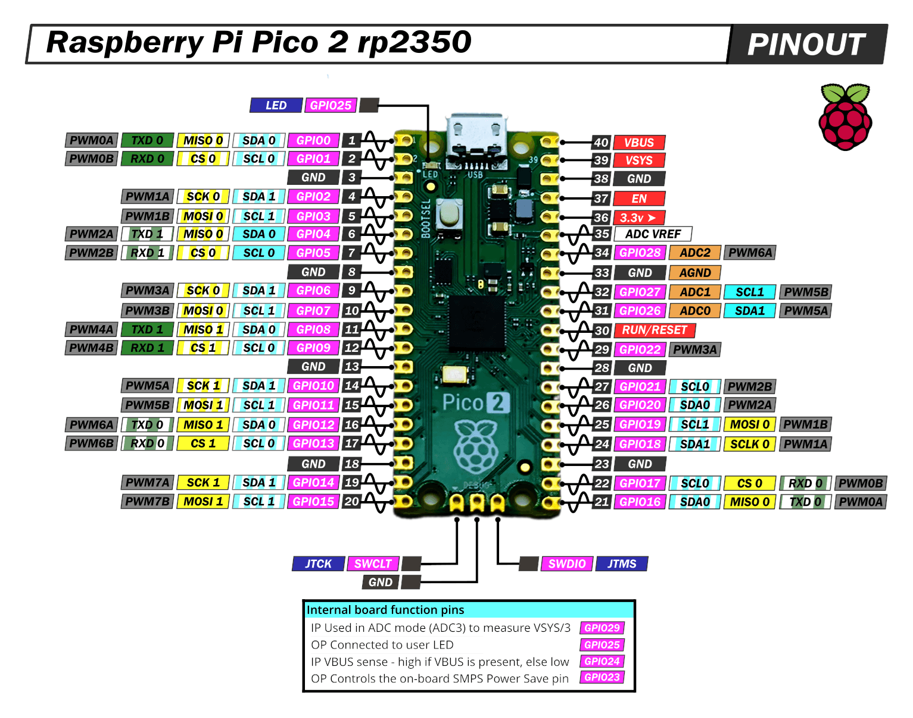

---

## Sistemas ESP32 (Xtensa / RISC-V)

  <strong>Plataforma IoT de Alto Desempeño</strong>

* **Matriz GPIO:** Desvincula geométricamente las señales. Un periférico puede derivarse instantáneamente hacia un pin de salida conveniente para enrutamiento de PCB.
* **Tolerancias de I2C:** Errores de silicio obligan a tener cautela extrema ante el *Clock Stretching* (esclavos lentos).
* **DMA para SPI:** Su motor requiere asignación explícita de buffers alojados estrictamente en DRAM.

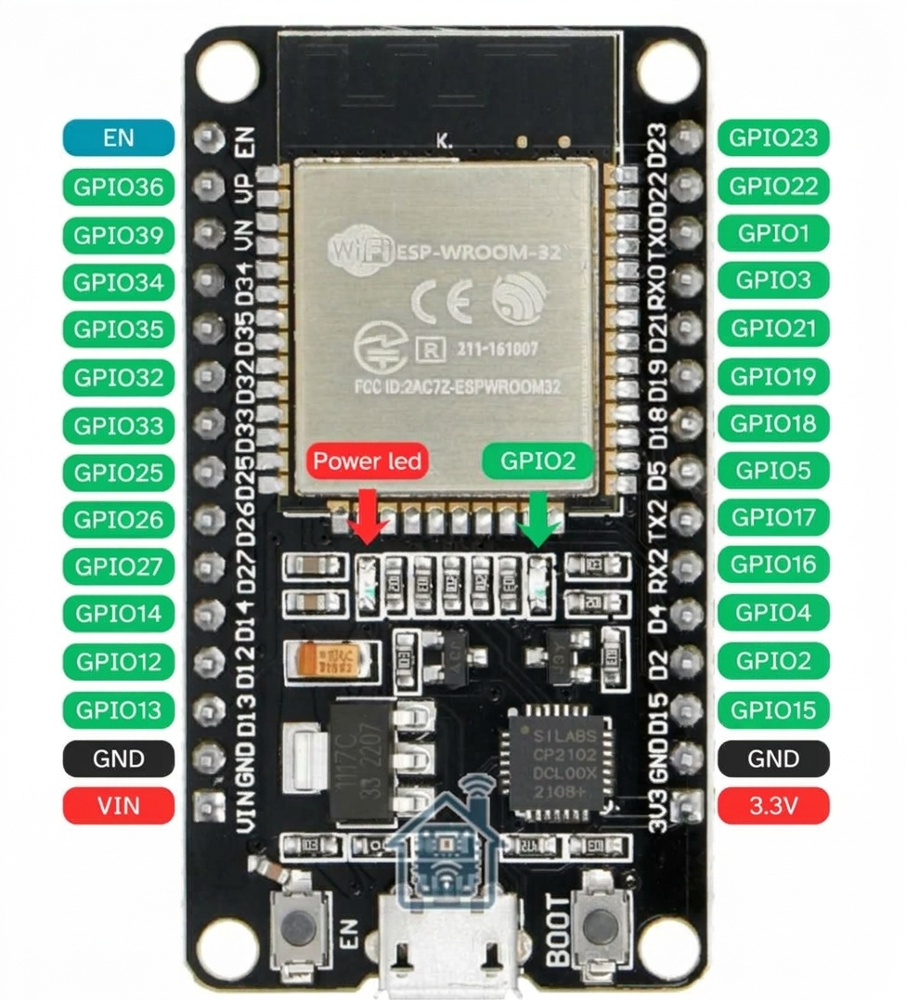

---

## Arduino Nano 33 BLE Sense en la Telesalud

  <strong>Wearables y Hardware de Borde</strong>

* **Topología Integral:** Diseño optimizado que pre-suelda los sensores más importantes de la materia sobre una placa compacta, sin requerir adaptaciones externas.
* **Sensores de placa (I2C):** Consta de un termómetro/higrómetro HTS221, un sensor inercial 9DOF (IMU) y el chip APDS9960 para gestometría de color/proximidad.
* **Control API:** Se gestionan de manera abstracta interactuando indirectamente con `Wire.h`.

---

---

## Programación de Protocolos en Arduino IDE

  <strong>Estructura Universal de Llamadas</strong>

* **Asíncrono:** `Serial.begin(115200)`. La adquisición emplea buffers y requiere validación mediante `Serial.available()`.
* **Esclavos de Red:** `Wire.begin()` configura I2C y `Wire.requestFrom()` demanda bloques de bytes a dispositivos específicos.
* **Alto Flujo:** `SPI.beginTransaction(SPISettings())` configura formato y sincronía de los paquetes MSB.

---

## Metodología de diseño 

  <strong>Adquisición, Procesamiento y Tramas</strong>

* Diagrama lógico
* Diagrama esquema
* Diagrama C4 (extenso)

---

Diagrama
lógico

---

Esquemático

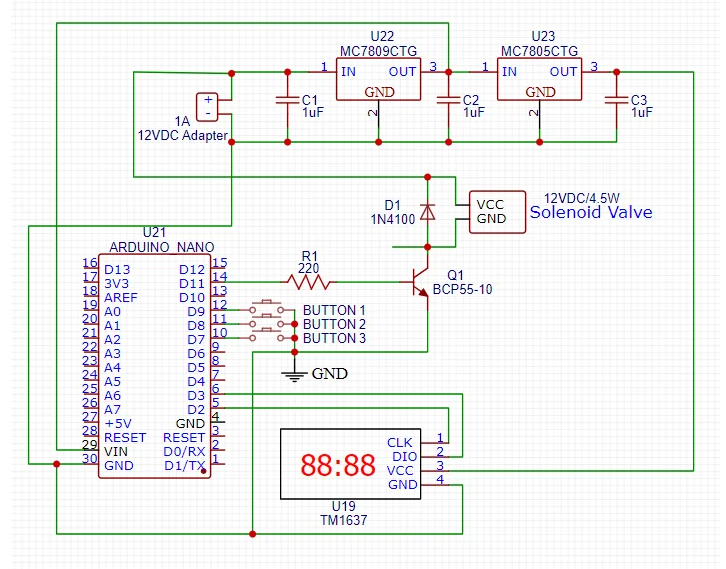

---
Diagrama
de flujo

---

Diagrama
 de casos

---
## Actividad 1 (Básica): El I2C Scanner

  <strong>Mapeo del Bus Multiesclavo</strong>

* **Propósito:** Inyectar rutinas de ping `Wire.beginTransmission()` hacia todos los registros 1–127 posibles en el Nano 33 BLE.
* **Resultado Esperado:** Detectar las firmas MAC/Hex decimales estáticas integradas en el silicio de cada sensor local y constatar el enrutamiento físico sano en I2C.

---

## Actividad 2 (Intermedia): Acondicionamiento Analítico

  <strong>Atenuación de Fluctuaciones Sensoriales</strong>

* **Extracción de Variables:** Solicitar datos del sensor nativo de temperatura/humedad (HTS221).
* **Filtro Promedio Móvil:** Operar un lazo `for` simple en C++ que acumule veinte ciclos, devolviendo el promedio lineal para suprimir el ruido blanco térmico antes de ser procesado como signo vital.

---

## Actividad 3 (Avanzada): Data Framing para Telesalud

  <strong>Construcción de Tramas de Telemetría JSON</strong>

* **Interconexión Dinámica:** Fusionar los datos de temperatura y acelerometría de 9 ejes en un formato estructurado legible (`{"dev_id": "BED01", "bpm": 72}`).
* **Disparo Serial:** Ejecutar la transmisión optimizada sobre la capa física del UART para derivar el arreglo a la sesión posterior del sistema IoT con Node-RED.

