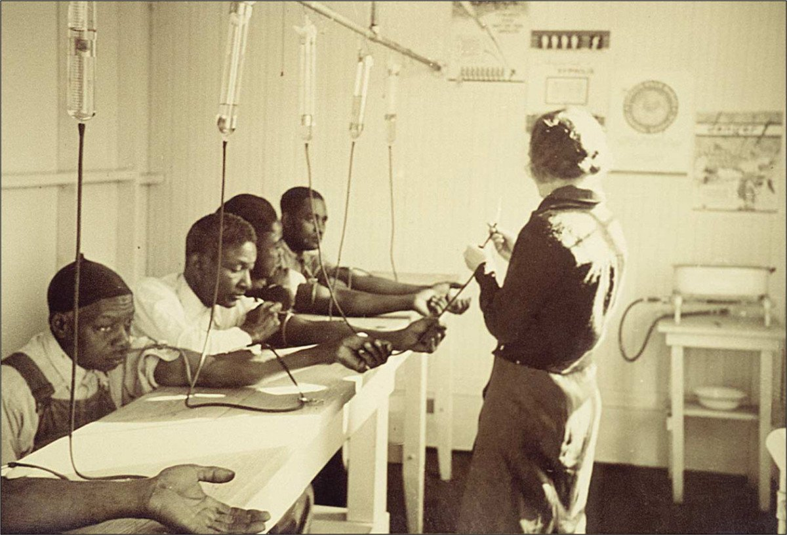
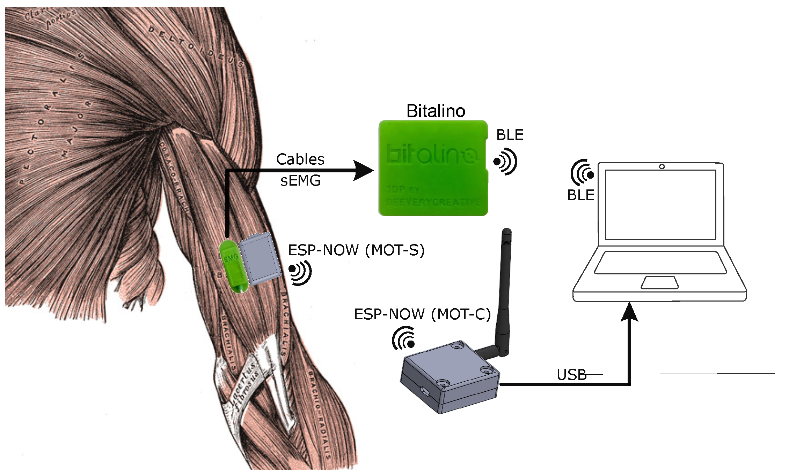
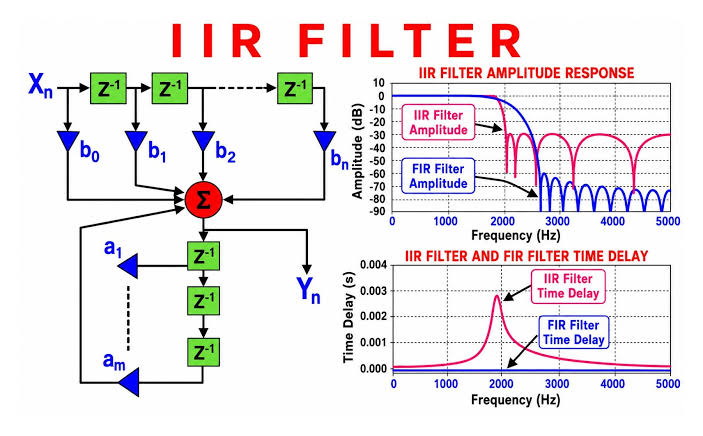
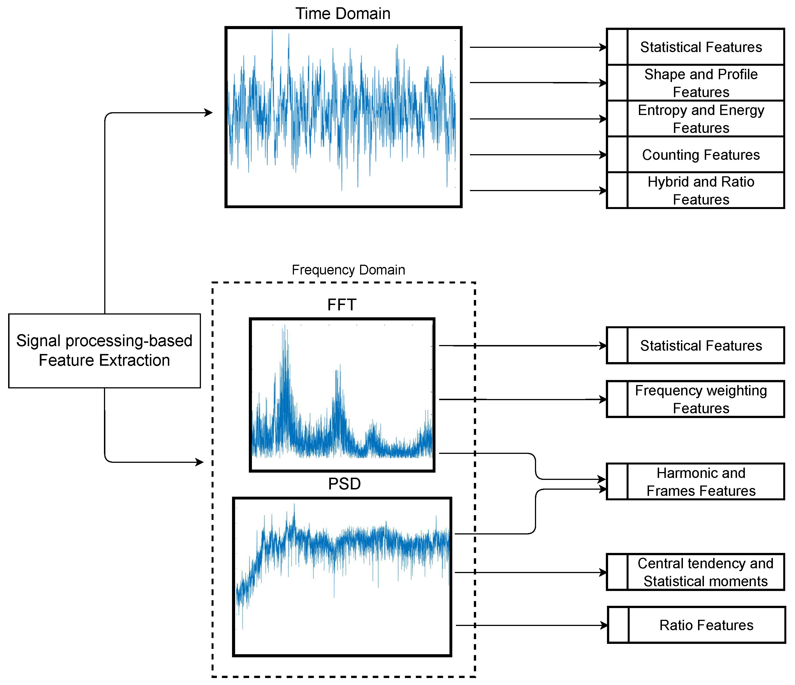

<div class="title-slide">
<div class="title-box">
  <h1>Diseño de Proyectos de Investigación en Señales Biomédicas</h1>
  <p style="margin: 5px 0 0 0; font-size: 18px; opacity: 0.9;">Marco Regulatorio, Metodología Experimental, Procesamiento e Interfaces</p>
</div>
<div class="subtitle">Introducción a Señales Biomédicas</div>
<div class="author" style="font-weight: bold; font-size: 18px; color: #111111; margin-top: 15px;">
  Mag. Ing. CIP Moises Meza Rodriguez
</div>
<div class="author" style="font-size: 15px; color: #555555; margin-top: 5px;">
  Facultad de Ciencias e Ingenieria
</div>
</div>

---

## Ciclo de Vida del Proyecto Biomédico

<div class="columns">
<div>

<div class="beamer-block">
  <strong>Estructuración Integral de la Investigación</strong>
</div>

* **Fase Regulatoria:** Clasificación institucional y aprobación ética previa a la recolección de datos.
* **Fase Experimental:** Adquisición de bioseñales mediante protocolos clínicos estandarizados o repositorios abiertos.
* **Procesamiento y Modelado:** Filtrado analógico/digital, extracción de características y algoritmos predictivos.
* **Despliegue Funcional:** Integración en interfaces humano-máquina (HMI) interactivas.

</div>
<div>


</div>
</div>

---

## Normativa Institucional UPCH: DUARI y ORVEI

<div class="columns">
<div>

<div class="beamer-block">
  <strong>Gobernanza de la Investigación</strong>
</div>

* **Vicerrectorado de Investigación:** Supervisa la calidad y cumplimiento regulatorio de todos los proyectos institucionales.
* **DUARI:** Dirección Universitaria de Asuntos Regulatorios de la Investigación; administra el registro oficial en la plataforma **SIDISI**.
* **ORVEI:** Oficina de Regulación y Valoración Ética de la Investigación; evalúa el alcance ético y clasifica las propuestas.
* **Requisito Obligatorio:** Ningún estudio puede recolectar datos sin dictamen formal aprobatorio.

</div>
<div>


</div>
</div>

<br>

- [https://investigacion.cayetano.edu.pe/duari/orvei/](https://investigacion.cayetano.edu.pe/duari/orvei/)

- [https://drive.google.com/file/d/1fG-Sc3N5EfAqfBL0x5DGKSE-ZzZLQr3w/view](https://drive.google.com/file/d/1fG-Sc3N5EfAqfBL0x5DGKSE-ZzZLQr3w/view)

---

## Clasificación de Estudios: Formatos Institucionales

<div class="columns">
<div>

<div class="beamer-block">
  <strong>Categorización de Protocolos en SIDISI</strong>
</div>

* **Formato F1:** Proyectos que involucran seres humanos de forma directa o indirecta.
* **Formato F2:** Investigaciones experimentales o con muestras del reino animal.
* **Formato F3:** Estudios que no involucran seres humanos ni animales en su ejecución.
* **Criterio de Selección:** La naturaleza del dato y el sujeto de estudio determinan el canal evaluador.

</div>
<div>


</div>
</div>

<br><br>

- [https://educacion.cayetano.edu.pe/wp-content/uploads/sites/17/2025/05/REGISTRO-DE-LOS-PROYECTOS-EN-SIDISI.pdf](https://educacion.cayetano.edu.pe/wp-content/uploads/sites/17/2025/05/REGISTRO-DE-LOS-PROYECTOS-EN-SIDISI.pdf)

- [https://psicologia.cayetano.edu.pe/wp-content/uploads/sites/21/2023/06/GUIA-PARA-REGISTRARSE-EN-CITIPROGRAM-1-2.pdf](https://psicologia.cayetano.edu.pe/wp-content/uploads/sites/21/2023/06/GUIA-PARA-REGISTRARSE-EN-CITIPROGRAM-1-2.pdf)

---

## Formato F1: Investigación con Seres Humanos

<div class="columns">
<div>

<div class="beamer-block">
  <strong>Alcance y Derivación al CIEI-UPCH</strong>
</div>

* **Definición:** Toda investigación donde se obtiene información mediante intervención física, interacción o biosensores sobre individuos.
* **Datos Sensibles:** Incluye registros clínicos privados identificables y bioseñales tomadas a voluntarios.
* **Evaluación:** Remitido directamente al **Comité Institucional de Ética en Investigación (CIEI-UPCH)**.
* **Compromiso:** Obliga a someter el Consentimiento Informado y declarar conflictos de interés.

</div>
<div>



</div>
</div>

<br>

- [https://drive.google.com/file/d/18sicUr7J4qFl97fflu6lSq3G-5OJrxr6/view](https://drive.google.com/file/d/18sicUr7J4qFl97fflu6lSq3G-5OJrxr6/view)

---

## Formato F2: Investigación con Modelos Animales

<div class="columns">
<div>

<div class="beamer-block">
  <strong>Comité Institucional de Ética para el Uso de Animales (CIEA)</strong>
</div>

* **Definición:** Proyectos que utilizan especímenes del reino *Animalia* en cualquier etapa de desarrollo embrionario o post-natal.
* **Intervención:** Comprende cirugías experimentales, monitoreo fisiológico invasivo o toma de biopotenciales *in vivo*.
* **Principio de las 3R:** Reemplazo, Reducción y Refinamiento como estándar bioético indispensable.
* **Ruta Regulatoria:** Dictaminado y supervisado estrictamente por el **CIEA-UPCH**.

</div>
<div>


</div>
</div>

---

## Formato F3: Estudios Sin Humanos ni Animales

<div class="columns">
<div>

<div class="beamer-block">
  <strong>Evaluación Directa por ORVEI / DUARI</strong>
</div>

* **Definición:** Investigaciones sin interacción directa con personas ni animales, y sin muestras biológicas identificables.
* **Casos Comunes en Ingeniería:**
  * Simulaciones matemáticas y diseño de circuitos de bioinstrumentación.
  * Análisis de datos sintéticos generados computacionalmente.
  * Pruebas de banco de hardware electrónico sin pruebas en voluntarios.
* **Resolución:** Dictaminado directamente por DUARI sin requerir sesión plenaria de comités éticos.

</div>
<div>


</div>
</div>

<br>

- [https://drive.google.com/file/d/1P1Gt2v6fVEHAFE15s_67i23L5T8X-xgh/view](https://drive.google.com/file/d/1P1Gt2v6fVEHAFE15s_67i23L5T8X-xgh/view)

---

## Categorías de Revisión Ética en el CIEI-UPCH

<div class="columns">
<div>

<div class="beamer-block">
  <strong>Estratificación Según Nivel de Riesgo</strong>
</div>

* **Sin Riesgo (Exenta):** Análisis secundario de datos públicos de acceso abierto completamente anonimizados.
* **Riesgo Mínimo (Parcial):** Procedimientos diagnósticos o de bioinstrumentación rutinarios no invasivos (ej. electrodos de superficie).
* **Riesgo Mayor (Completa):** Ensayos clínicos con dispositivos médicos no certificados o pruebas que alteren variables fisiológicas críticas.
* **Temporalidad:** Constancias emitidas por 1 a 5 años según la categoría aprobada.

</div>
<div>


</div>
</div>

---

## Ruta A: Uso de Repositorios y Datasets Públicos

<div class="columns">
<div>

<div class="beamer-block">
  <strong>Aceleración de Algoritmos con Datos Validados</strong>
</div>

* **PhysioNet:** Estándar mundial en señales clínicas (MIT-BIH Arrhythmia, PTB-XL ECG, CHB-MIT EEG).
* **Kaggle y UCI:** Repositorios abiertos para validación cruzada y retos competitivos de machine learning.
* **Ventajas Metodológicas:**
  * Cohortes de gran escala con anotaciones de médicos expertos.
  * Exención ética directa al tratarse de datos secundarios anonimizados.
* **Herramientas de Carga:** Uso de librerías como `wfdb-python` para parsing directo.

</div>
<div>


</div>
</div>

---

## Ruta B: Adquisición Experimental con Sensores

<div class="columns">
<div>

<div class="beamer-block">
  <strong>Kit BITalino e Instrumentación Propia</strong>
</div>

* **Plataforma BITalino (r)evolution:** Sistema de bioadquisición con comunicación Bluetooth/BLE y muestreo hasta 1000 Hz.
* **Sensores de Superficie Disponibles:**
  * **EMG:** Actividad eléctrica muscular y fatiga neuromuscular.
  * **ECG:** Ritmo cardíaco y ondas P-QRS-T.
  * **EEG:** Ondas cerebrales y ritmos corticales.
  * **EOG:** Dinámica de movimientos oculares y sacadas.
* **Reto:** Requiere calibración, acondicionamiento y protocolo F1 de riesgo mínimo.

</div>
<div>



[https://www.mdpi.com/1424-8220/25/12/3600](https://www.mdpi.com/1424-8220/25/12/3600)

</div>
</div>


---

## Buenas Prácticas y Protocolos Experimentales

<div class="columns">
<div>

<div class="beamer-block">
  <strong>Garantía de Repetibilidad y Calidad</strong>
</div>

* **Preparación del Sujeto:** Limpieza dérmica con alcohol isopropílico para reducir la impedancia de contacto electrodo-piel.
* **Ubicación de Electrodos:** Seguir recomendaciones internacionales (normas SENIAM para electromiografía de superficie).
* **Instrumento de Recolección Estandarizado:** Registro riguroso de temperatura ambiental, hora de prueba, fatiga y posición anatómica.
* **Aislamiento Eléctrico:** Uso de fuentes a batería (Li-Po) para garantizar seguridad intrínseca del voluntario.

</div>
<div>


</div>
</div>

---

## Recorte de la señal

<div class="columns">
<div>

* **Conversor ADC:** Cuantización y codificación (10 bits de resolución para señales biológicas en bitalino).
* Cada grabación de señal debe estar recortada en unidades de análisis.

```python
import numpy as np
from numpy.lib.stride_tricks import sliding_window_view
x = np.arange(6)
x.shape
v = sliding_window_view(x, 3)
v.shape
v
array([[0, 1, 2],
       [1, 2, 3],
       [2, 3, 4],
       [3, 4, 5]])
```

</div>
<div>


</div>
</div>

---

## Acondicionamiento y Filtrado Digital

<div class="columns">
<div>

<div class="beamer-block">
  <strong>Eliminación de Ruido e Interferencias</strong>
</div>

* **Filtros Notch (Rechazo de Banda):** Eliminación precisa de armónicos de red eléctrica (50/60 Hz).
* **Filtros FIR (Finite Impulse Response):**
  * Fase estrictamente lineal: preserva la morfología temporal del complejo ECG.
* **Filtros IIR (Butterworth / Chebyshev):**
  * Alta selectividad con bajo orden y mínimo consumo computacional.
* **Remoción de Línea Base:** Filtros pasaaltos con corte a 0.05 Hz para compensar respiración y transpiración.

</div>
<div>



</div>
</div>

---

## Extracción de Características: Dominio Temporal y Frecuencial

<div class="columns">
<div>

<div class="beamer-block">
  <strong>Feature Engineering en Señales Fisiológicas</strong>
</div>

* **Dominio del Tiempo:**
  * Media Absoluta (MAV), Raíz Cuadrada Media (RMS), Cruces por Cero (ZC) y Longitud de Onda (WL).
* **Dominio de la Frecuencia (Espectral):**
  * Densidad Espectral de Potencia (PSD mediante periodograma de Welch).
  * Frecuencia Media (MNF) y Mediana (MDF) para cuantificar fatiga muscular.
* **Reducción de Dimensionalidad:** Selección de parámetros informativos clave.

</div>
<div>



</div>
</div>

---

## Análisis Avanzado: Transformada Wavelet (DWT)

<div class="columns">
<div>

<div class="beamer-block">
  <strong>Resolución Multiescala Tiempo-Frecuencia</strong>
</div>

* **Limitación de Fourier:** Pierde la localización temporal exacta de transitorios rápidos.
* **Transformada Wavelet Discreta (DWT):** Descomposición piramidal mediante bancos de filtros en coeficientes de aproximación y detalle.
* **Familias Comunes:** *Daubechies* (db4 para picos QRS), *Symlets* y *Coiflets*.
* **Aplicaciones:** Detección de espigas epileptogénicas en EEG y segmentación de potenciales de acción en EMG.

</div>
<div>


</div>
</div>

---

## Análisis Bioestadístico de Señales

<div class="columns">
<div>

<div class="beamer-block">
  <strong>Inferencia y Contraste de Hipótesis</strong>
</div>

* **Diferencia de Medias:**
  * Prueba t de Student (datos paramétricos) o Wilcoxon / Mann-Whitney (no paramétricos).
* **Análisis Multivariado:** ANOVA de una o dos vías para comparar múltiples grupos o estados neuromusculares.
* **Correlación de Eventos:** Coeficientes de Pearson y Spearman para evaluar sincronicidad entre bioseñales y eventos externos.
* **Significancia Clínica:** Tamaño del efecto ($d$ de Cohen) junto con el valor $p < 0.05$.

</div>
<div>


</div>
</div>

---

## Machine Learning Clásico para Clasificación

<div class="columns">
<div>

<div class="beamer-block">
  <strong>Modelos Supervisados sobre Vectores de Características</strong>
</div>

* **Support Vector Machines (SVM):** Excelente desempeño en clasificación binaria de patrones EMG y arritmias con fronteras no lineales (kernel RBF).
* **Random Forest y Ensembles:** Robusto frente a ruido de sensor y capaz de rankear la relevancia de características fisiológicas.
* **Validación Cruzada Estratificada:** K-Fold cross-validation para evitar sobreajuste en cohortes biomédicas reducidas.
* **Métricas de Evaluación:** Sensibilidad, especificidad, precisión y matriz de confusión.

</div>
<div>


</div>
</div>

---

## Deep Learning Aplicado a Bioseñales

<div class="columns">
<div>

<div class="beamer-block">
  <strong>Modelado de Extremo a Extremo (End-to-End)</strong>
</div>

* **Redes Neuronales Convolucionales 1D (1D-CNN):** Extracción automática de filtros espaciales directamente sobre la señal temporal cruda.
* **Espectrogramas + 2D-CNN:** Transformación de EEG/EMG en imágenes tiempo-frecuencia para redes preentrenadas.
* **Redes Recurrentes (LSTM / GRU) y Transformers:** Captura de dependencias temporales y ritmos fisiológicos de largo plazo.
* **TinyML:** Cuantización e inferencia optimizada sobre microcontroladores embebidos.

</div>
<div>


</div>
</div>

---

## Despliegue en Interfaces Humano-Máquina (HMI)

<div class="columns">
<div>

<div class="beamer-block">
  <strong>Cierre Tecnológico: Aplicación Clínica e Interactiva</strong>
</div>

* **Interfaces Web / Dashboards de Diagnóstico:**
  * Plataformas en Python (Streamlit / Dash) para visualización de registros, reportes automáticos y telemonitoreo.
* **Sistemas Interactivos en Tiempo Real:**
  * Control de prótesis robóticas mediante clasificación de patrones EMG.
  * Interfaz Cerebro-Computadora (BCI) basada en ritmos EEG para neurorehabilitación.
  * Biofeedback y control de videojuegos usando señales musculares u oculares (EOG).

</div>
<div>


</div>
</div>

---


---


---


---

## Conclusiones y Entregables del Curso

<div class="columns">
<div>

<div class="beamer-block">
  <strong>Resumen del Pipeline del Proyecto</strong>
</div>

* **Rigor Ético:** Cumplimiento de formatos DUARI/ORVEI (F1/F2/F3) como paso cero innegociable.
* **Integración Multidisciplinar:** Fisiología, electrónica, procesamiento digital y ciencia de datos integrados.
* **Formato Publicable:** Presentación final en formato de artículo científico IEEE y póster académico.
* **Prototipo Validado:** Demostración en vivo de la interfaz HMI o plataforma de análisis desarrollada.

</div>
<div>


</div>
</div>