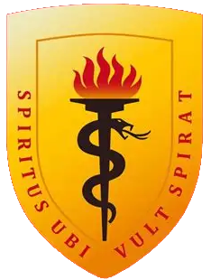

<!-- _class: title -->

# Introducción a la Transformada Wavelet

Multirate , bancos de filtros y aplicaciones biomédicas

> Mag. Ing. CIP Moises Meza Rodriguez

---
<!-- _header: ¿Qué es una Wavelet? -->

<div class="columns">
<div>

Una wavelet es una ondicula que se utiliza para analizar señales a múltiples escalas.

Características:

* Duración finita
* Localización temporal
* Multiescala
<br>

A diferencia de Fourier:

* No usa senos infinitos
* Conserva información temporal

</div>
<div class="img-right">

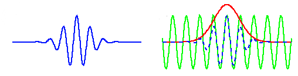

</div>
</div>

---
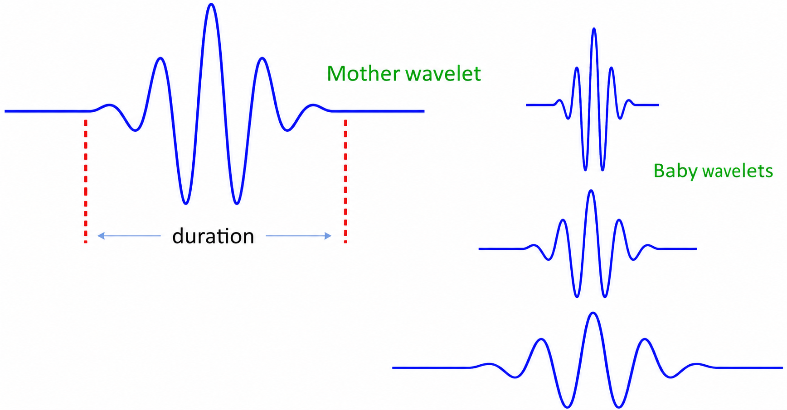
<!-- _header: Wavelet madre -->

La wavelet base se representa como: $\psi(t)$

Las demás wavelets se obtienen mediante:

* Escalamiento
* Traslación

<br>

$\psi_{a,b}(t)=\frac{1}{\sqrt{|a|}}\psi\left(\frac{t-b}{a}\right)$

---
<!-- _header: Escala y frecuencia -->
<div class="columns">
<div>

## Escala pequeña

* Wavelet comprimida
* Altas frecuencias
* Eventos rápidos

## Escala grande

* Wavelet expandida
* Bajas frecuencias
* Tendencias lentas

</div>
<div class="img-right">


</div>
</div>

---

<!-- _header: ¿Por qué estudiar Wavelets? -->

<div class="columns">
  <div >
    La transformada wavelet permite analizar señales:

    - No estacionarias
    - Transitorias
    - Multiescala
    - Tiempo–frecuencia

  </div>

  <div class="img-right">

  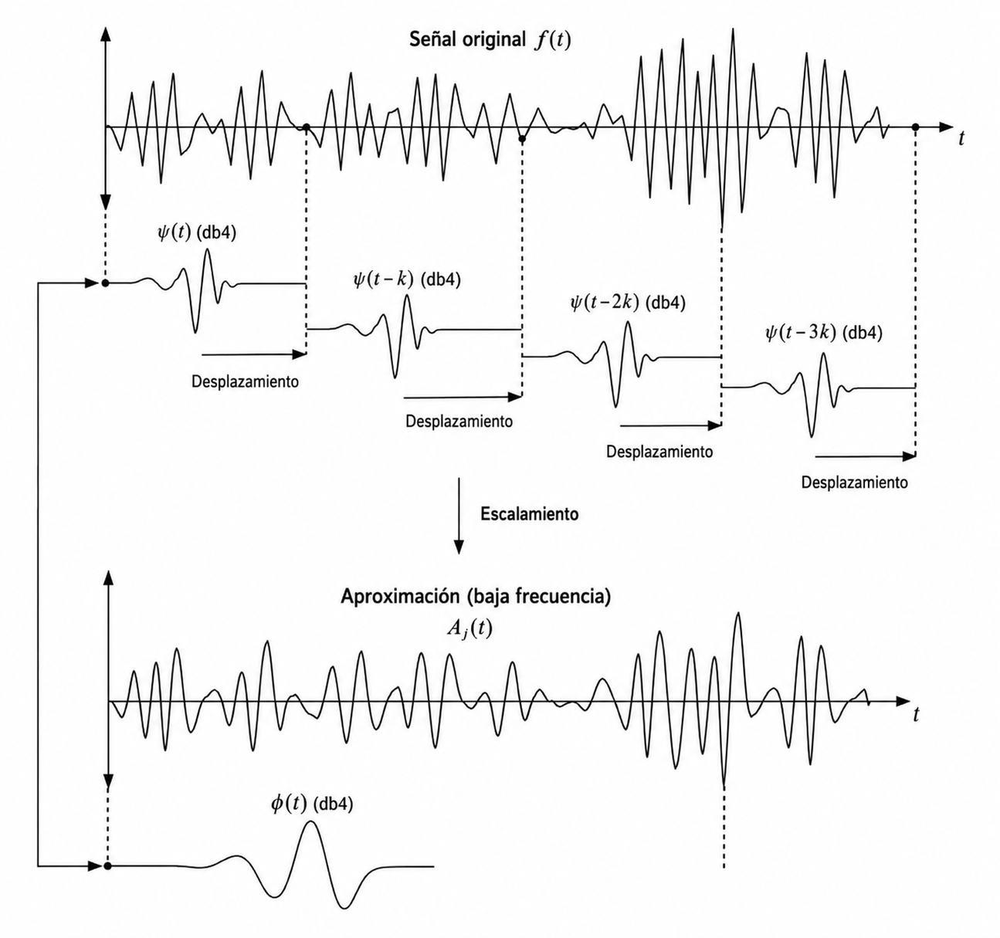
  </div>

</div>

---
<!-- _header: Scalogram -->

<div class="columns">
<div>

Representación tiempo–frecuencia.

Ejes:

* X → tiempo
* Y → escala/frecuencia
* Color → energía

Muy usado en:

* EEG
* Audio
* Sismología

</div>
<div class="img-right">

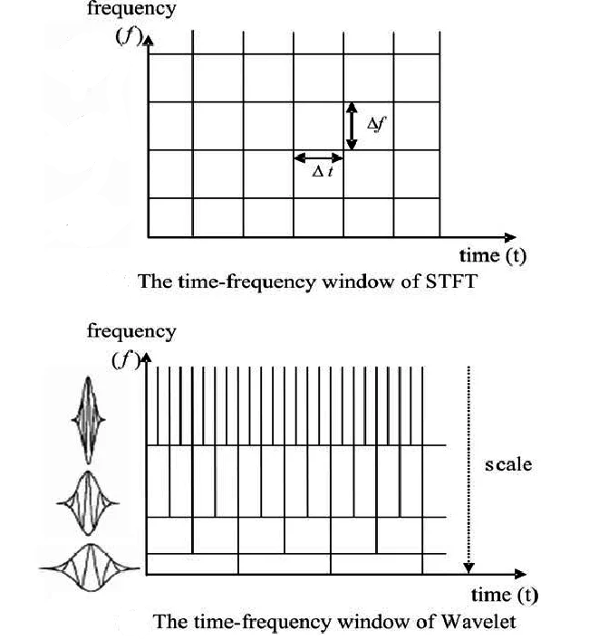

</div>
</div>


---

<!-- _header: Transformada Wavelet Continua -->

$
W(a,b)=\frac{1}{\sqrt{|a|}}\int_{-\infty}^{\infty}x(t)\psi^*\left(\frac{t-b}{a}\right)dt
$

## Idea intuitiva

La wavelet se desplaza sobre la señal preguntando:

> “¿La señal se parece a mí en este instante y esta escala?”

---
<!-- _header: Transformada Wavelet Continua -->

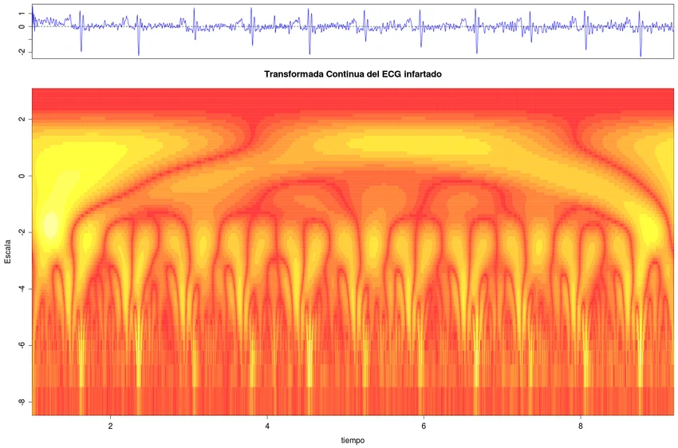

---

<!-- _header: PyWavelets -->

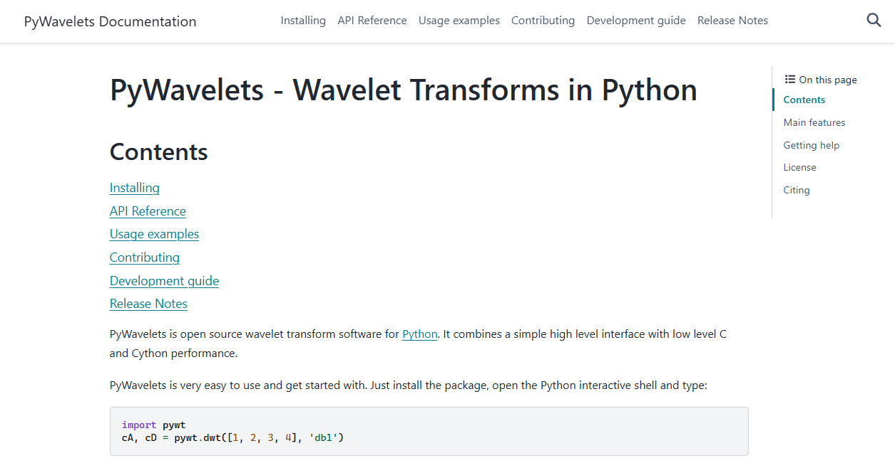

---
<!-- _header: Transformada Wavelet Continua -->
```python
!pip install pywavelets
```
```python
import pywt
pywt.families()
#pywt.wavelist(kind='continuous')
```
> ['haar', 'db', 'sym', 'coif', 'bior', 'rbio', 'dmey', 'gaus', 'mexh', 'morl', 'cgau', 'shan', 'fbsp', 'cmor']


---

<!-- _header: Transformada Wavelet Discreta -->

<div class="columns">
<div>

La DWT utiliza:

* Bancos de filtros
* Decimación
* Multiresolución
<br>

Produce:

* Aproximaciones
* Detalles

<br>

Es una de las técnicas más utilizada en DSP.

</div>
<div class="img-right">

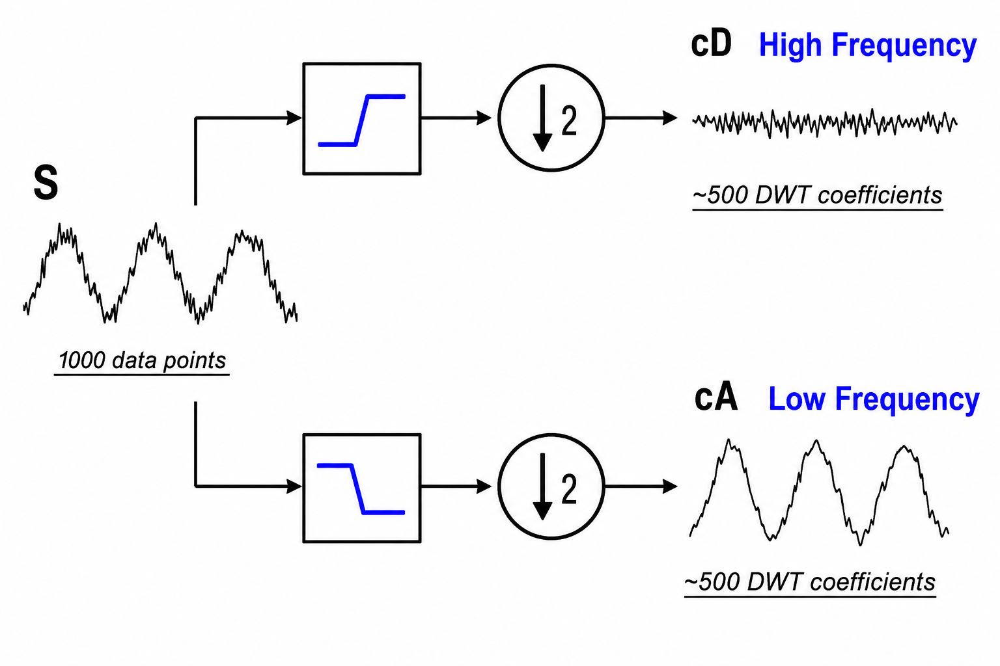

</div>
</div>

---
<!-- _header: Transformada Wavelet Discreta -->


---
<!-- _header: Transformada Wavelet Discreta -->
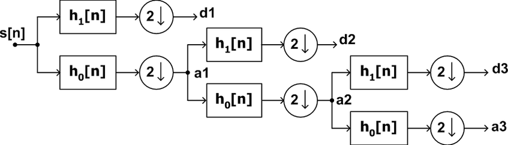

---


<!-- _header: Decimación (Downsampling) -->

  La decimación reduce la frecuencia de muestreo.

  > $y[n]=x[Mn]$ 
  > fs/2

  Si:
  >  $M=3$

  Entonces se conserva:

  *  Tres muestras de "$x$" serian una de "$y$" 
 

  Ejemplo:

  > $[1,2,3,4,5,6,7] \rightarrow [1,4,7]$ 

---

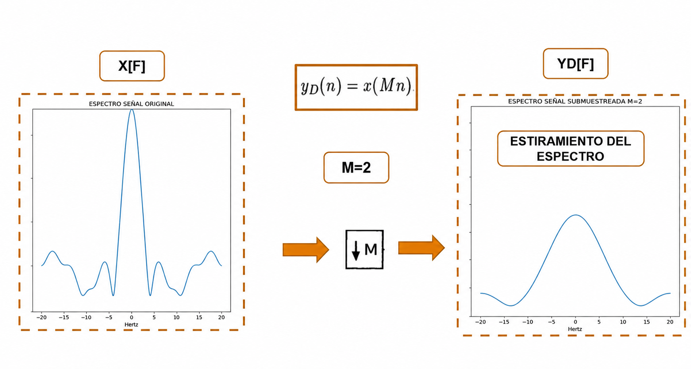

---


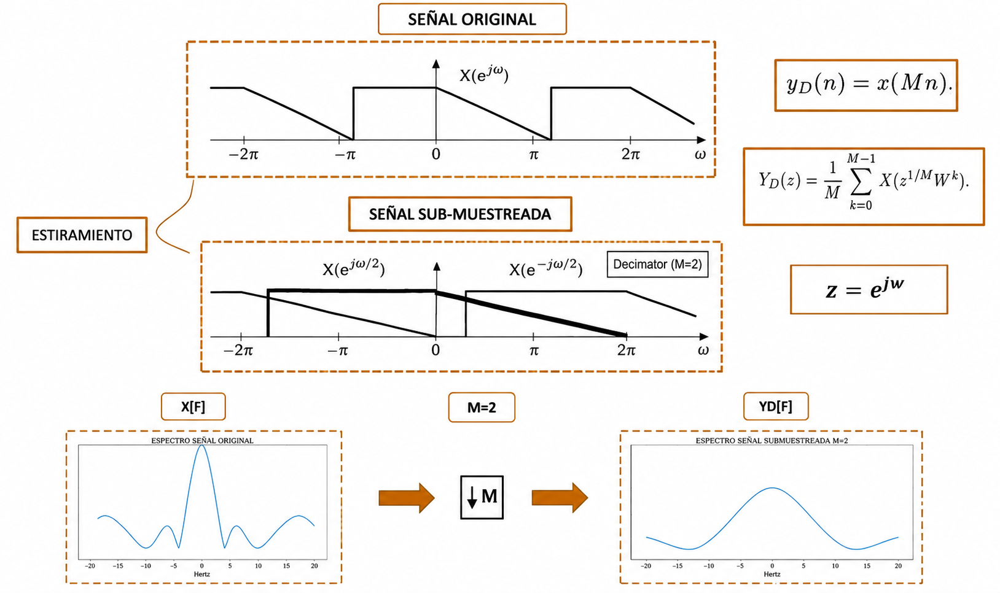

---
<!-- _header: Aliasing -->

<div class="columns">
  <div>

  La decimación directa produce:

  * Superposición espectral
  * Distorsión
  * Pérdida de información
  * Por ello antes de decimar se utiliza Filtro pasa bajos antialiasing

  </div>

  <div class="img-right">

  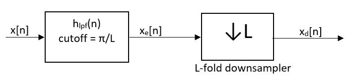

  </div>
</div>

---
<!-- _header: Interpolación (Upsampling) -->

<div class="columns">
  <div>

  La interpolación aumenta la frecuencia de muestreo.

  Proceso:

  1. Insertar ceros
  2. Filtrar

  $y[n]= \begin{cases}
  x[n/L] & n=kL\
   & \text{otro caso}
  \end{cases}$

  Ejemplo:

  $[1,2,3] \rightarrow [1,0,2,0,3,0]$

  </div>
<div class="img-right">

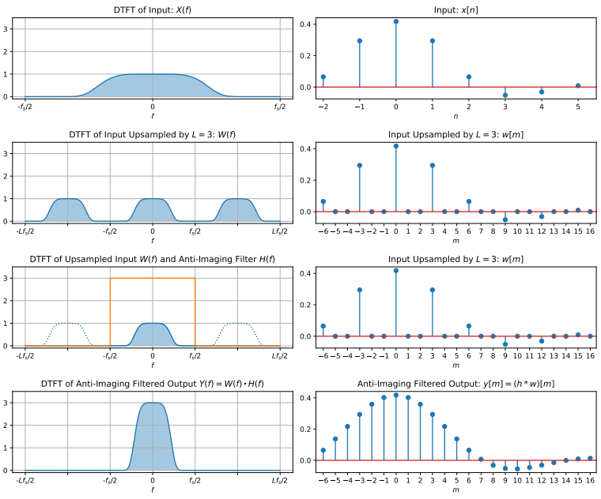

</div>
</div>

---


---
<!-- _header: Banco de filtros -->


Un banco de filtros divide la señal en subbandas frecuenciales.

## Componentes

* LPF → bajas frecuencias
* HPF → altas frecuencias

## Resultado

* Aproximación
* Detalle


---

# Aproximaciones y detalles

| Componente   | Contenido         |
| ------------ | ----------------- |
| Aproximación | ? |
| Detalle      | ? |

## Detalles contienen

* Bordes
* Transitorios
* Ruido
* Eventos rápidos

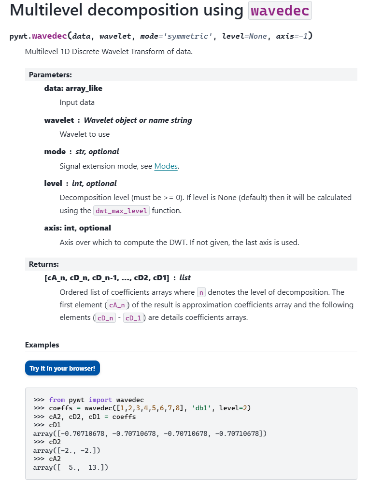

---

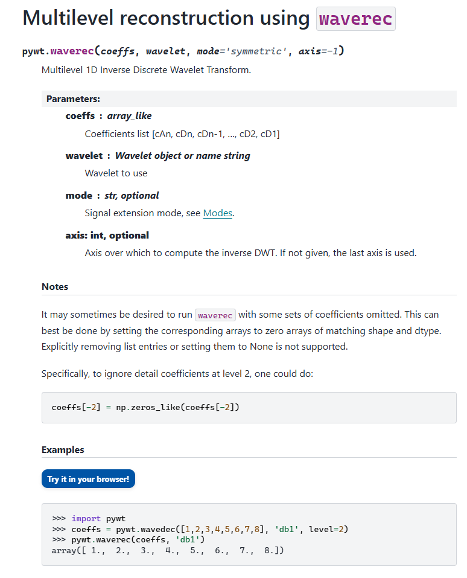

---

# Familias de Wavelets <!--fit-->

| Familia    | Característica     |
| ---------- | ------------------ |
| Haar       | Muy simple         |
| Daubechies | Muy usada en ECG   |
| Symlets    | Más simétrica      |
| Coiflets   | Más momentos nulos |
| Morlet     | Excelente para CWT |

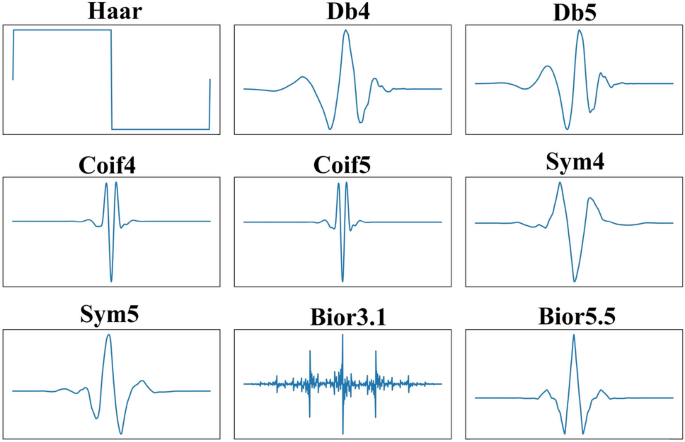

---

# Wavelet Haar


$
\psi(t)=
\begin{cases}
1 & 0\le t<\frac{1}{2}\\
-1 & \frac{1}{2}\le t<1\\
0 & \text{otro caso}
\end{cases}
$

## Características

* Muy rápida
* Discontinua
* Fácil implementación

---
<!-- _header: Aplicaciones biomédicas
 -->
<div class="columns">
<div>

### ECG

* Detección QRS
* HRV

### EEG

* Epilepsia
* Bandas cerebrales
* Artefactos

### EMG

* Fatiga muscular
* Activación muscular

</div>
<div class="img-right">

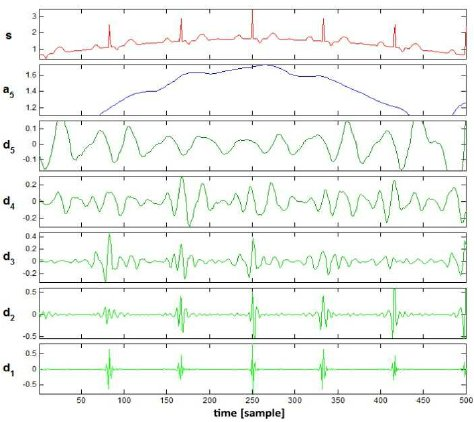

</div>
</div>

---

# Pipeline de procesamiento


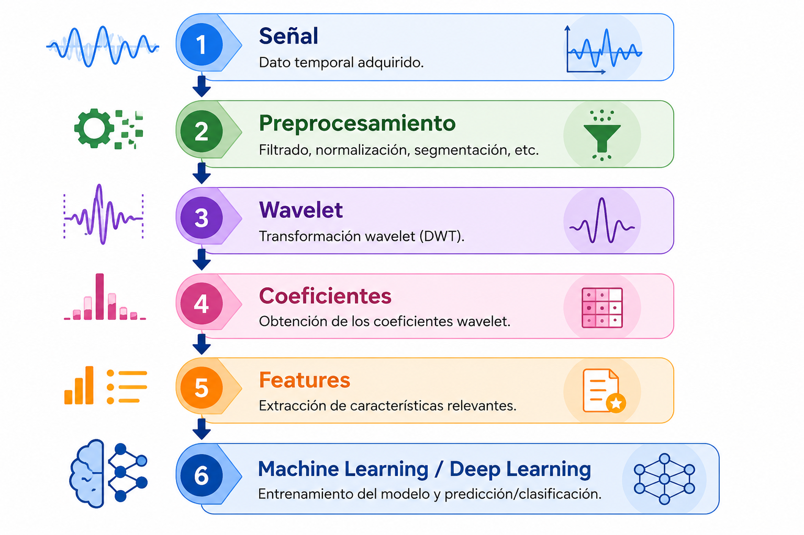

## Puntos importantes

* Elegir bien los niveles para denoising
* Elegir bien una wavelet madre segun papers
* Aplicar threshold adapatativo 


---

# Código Python — DWT

```python
import numpy as np
import pywt
import matplotlib.pyplot as plt

fs = 1000
t = np.linspace(0,1,fs)
x = np.sin(2*np.pi*10*t)

coeffs = pywt.wavedec(
    x, 'db4', level=4
)

coeffs[-1] = np.zeros_like(coeffs[-1])
coeffs[-2] = np.zeros_like(coeffs[-2])

y = pywt.waverec(coeffs, 'db4')
```
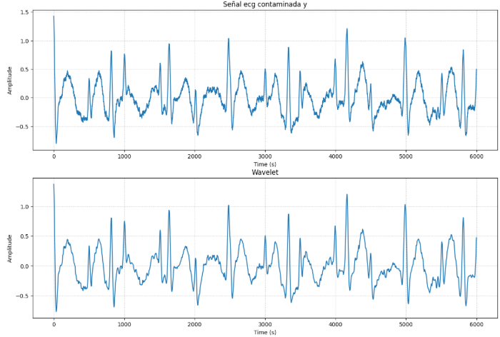

---

# Código Python — CWT

```python
import neurokit2 as nk

f, t, cwtm = nk.signal_timefrequency(
    ecg_signal,
    sampling_rate,
    max_frequency=30,
    method="cwt_cmor1.5-1.0",
    show=True
    )
```
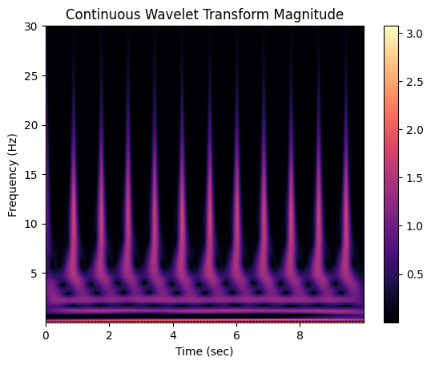

---
<!-- _header:  Relación con Deep Learning -->
#

<div class="columns">
<div>

Actualmente existen enfoques híbridos:

* Wavelet + CNN
* Wavelet Scattering
* CNN sobre scalograms
* Features wavelet para ML

<br>


> Las CNN aprenden filtros automáticamente

</div>
<div class="img-right">

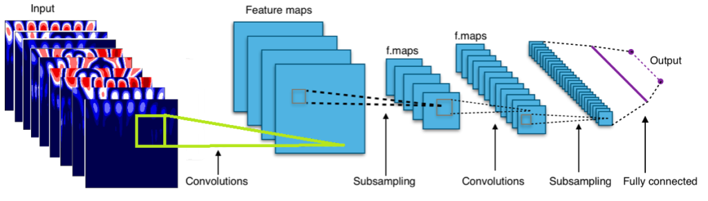

</div>
</div>

---
<!-- _header: Super intro a filtros adaptativos (LMS) -->

Los filtros tradicionales poseen coeficientes fijos.

Cuando las características del ruido cambian con el tiempo, estos filtros pueden perder eficacia.

El LMS ajusta automáticamente sus coeficientes para minimizar el error entre una señal deseada y la salida del filtro.

$$e(n)=d(n)-y(n)$$


### Ejemplo: **Cancelación Activa de Ruido (ANC)**

Los auriculares modernos utilizan filtros adaptativos para aprender el ruido ambiental y cancelarlo en tiempo real.

---
<!-- _header: Partes de un filtros adaptativo LMS -->
<br>

```
- Filtro FIR adaptativo
- Error e(n)
- Algoritmo de actualización
```

> $$e(n)=d(n)-y(n)$$
> $$w(n+1)=w(n)+\mu e(n)x(n)$$

donde:

- $w(n)$ = coeficientes actuales
- $\mu$ = velocidad de aprendizaje
- $x(n)$ = ruido de referencia
- $d(n)$ = señal deseada 
> d(n)=ECG(n)+x(n)

<br>

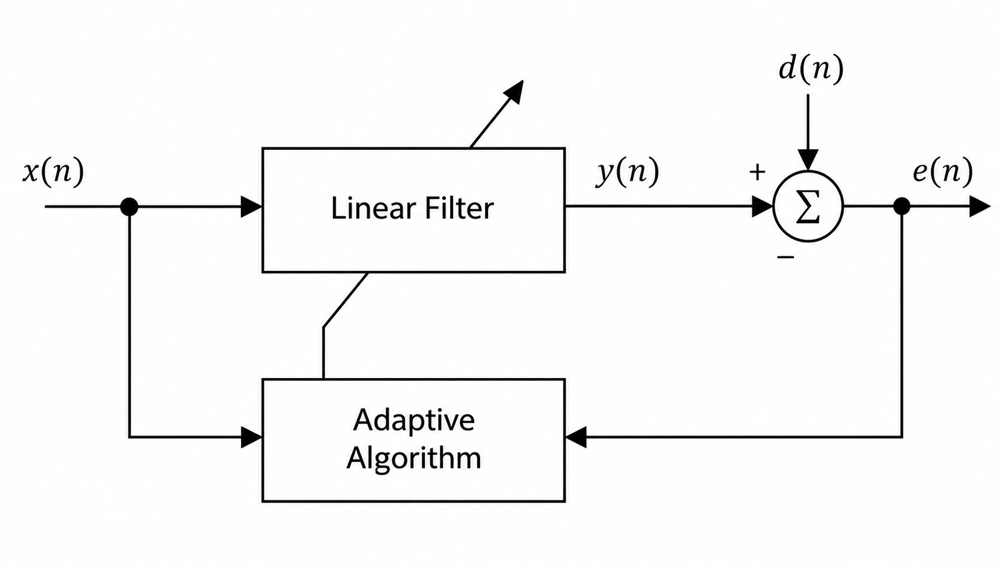

---

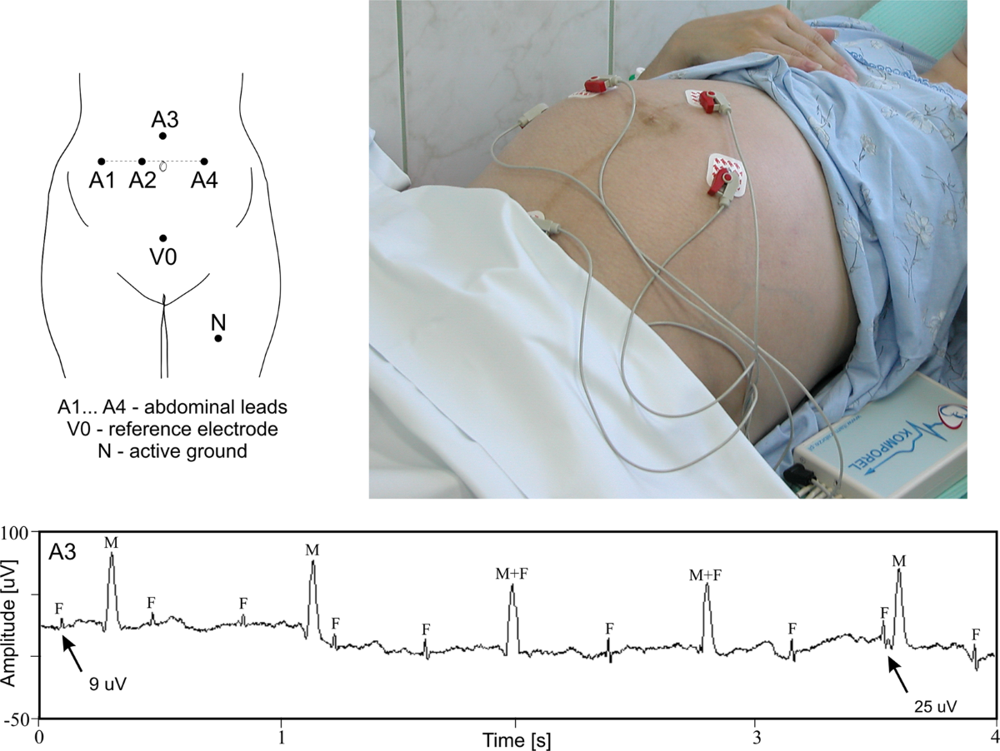

<br><br><br><br><br><br><br><br><br><br><br><br><br>
DOI: https://doi.org/10.1038/s41597-020-0538-z

---

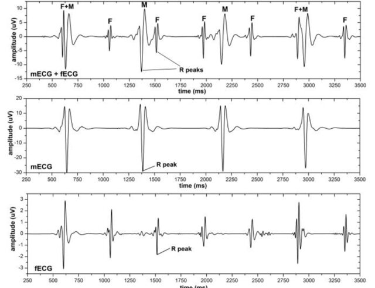

<br><br><br><br><br><br><br><br><br><br><br><br><br>
DOI: 10.1109/EHB.2015.7391357

---


# GRACIAS TOTALES!

## Nooo, vamos al código!

link: https://drive.google.com/drive/folders/1pa2yOZy0g54EY9FwUdlhxtZg4HuB0WFZ?usp=sharing


